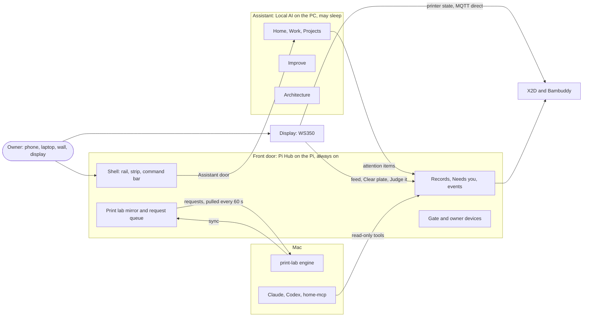
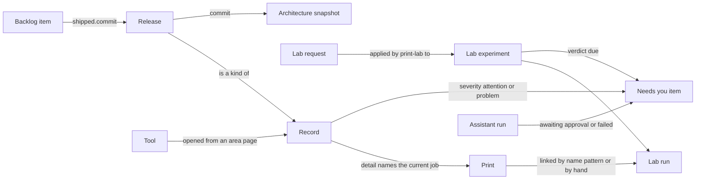
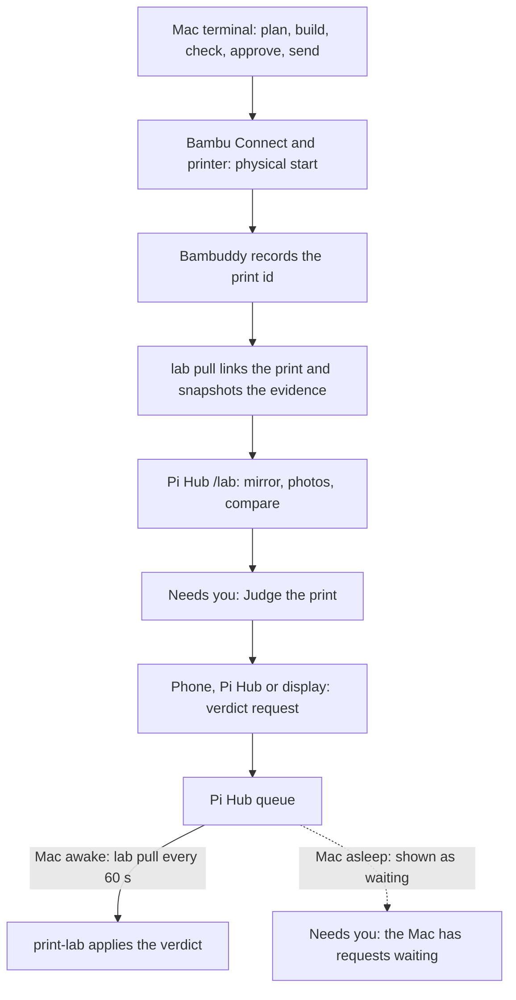
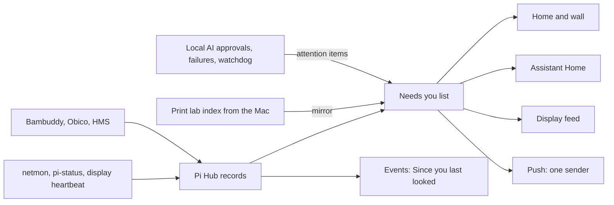

# Platform product architecture: one product from the approved designs (design)

Date: 2026-11-01 · Status: decisions D1-D9 approved by the owner on 1 Nov 2026, with four amendments and a rewording of D4 (section 12).
C1 (Backblaze B2) and D2's service (Healthchecks.io) approved the same day.
**Baseline**: the authoritative platform architecture; implementation PRs follow it, and changes to it are
amendments. Documentation only; no code, config or deploy changes.
Type: product architecture. It reconciles the approved designs of the owner's home platform into one product, and
changes an earlier decision only where the evidence says it no longer fits.

**Where this lives.** Pi Hub's repository is only the administrative home of this spec, until a `home-platform`
repository exists. That is a filing convenience. It is not a claim that Pi Hub owns the platform. The platform is the
product described here. Pi Hub is one runtime that serves its front door (section 2).

**Who it is for:** the owner alone, on the Mac, the Windows PC and the iPhone, plus the wall and the display. One
Home's decision stands: the household and the kids are not users.

**How to read the evidence.**

- *Report* is `/Users/billrahe/dev/ENGINEERING_ECOSYSTEM_ARCHITECTURE_ASSESSMENT.md` (1 Nov 2026). It lives outside any
  repository. Citations are `Report l.<line>`.
- Pi Hub specs are cited as `one-home`, `control-room`, `one-print`, `one-needs-you`, `lab-on-hub`, `display-on-hub`,
  `device-owner` and `real-names`, with line numbers from `docs/superpowers/specs/` in this repository.
- LocalAI specs are cited as `evolution`, `nav-home-work`, `nav-structure`, `improve`, `notifications`,
  `phone-redesign`, `web-critique`, `aw-*` (agent world), `coordinator` (model coordinator), `forgejo` and `household`
  (`docs/HOUSEHOLD-SYSTEM.md`). They were read from `origin/main`, because the local checkout is 67 commits behind
  (Report l.100). `registry` is `app/public/view-registry.js` and `deployments` is `docs/DEPLOYMENTS.md`, also from
  `origin/main`. `forgejo` exists only in the `LocalAI-forgejo` worktree.
- print-lab specs are `pl-design`, `pl-one-home`, `pl-roadmap`, `pl-verdicts`, `pl-act-live` and `pl-obs`. appliance-ui
  specs are `kit-look` and `kit-faceplate`. The display spec is `display-card`. home-mcp is `home-mcp`.
- Code is cited as `file:line` in this repository at `origin/main` (`ab63b26`).

**Verdicts.** *Kept* means the decision stands as written. *Extended* means it stands and this spec adds to it.
*Superseded* means it is replaced in whole or in part, and the row says by what and why.

## 1. Reconciliation

### 1.1 Outcome

Most decisions are kept. The product the owner already designed is coherent: Pi Hub is the front door and the one
place that knows the house's state, LocalAI is the AI service, print-lab is the Mac-side experiment engine, and the
display is a device client. The designs disagree in a few places because they were written in a week while the ground
moved. These are the conflicts found, and how each is resolved.

| # | Conflict | Resolved as | Where |
|---|---|---|---|
| K1 | Print lab's one UI is LocalAI (`pl-one-home`, `pl-roadmap`, `pl-verdicts`, `pl-act-live`) or Pi Hub (`lab-on-hub`) | Pi Hub `/lab`. LocalAI's tab redirects now; its backend goes when no caller remains (D5) | 1.3, 5 |
| K2 | The display's connection is LocalAI (`household`:15, `display-card`:23) or Pi Hub (`display-on-hub` D1) | Pi Hub | 1.2, 1.3, 7 |
| K3 | Lab Needs-you items come from LocalAI `/api/needs` (`one-needs-you` N1, N8), from Pi Hub's own copy (`lab-on-hub` L10), or LocalAI `/api/attention` (`household`:41) | Pi Hub builds lab items from its mirror. LocalAI's `/api/attention` carries only LocalAI's own items. LocalAI has no `/api/needs` route (only the client call at `app/pi-hub.js:112`) | 1.1, 4 |
| K4 | `real-names` PR 5 retires `home.arpa` and `/home-ca.crt` (l.50-53). The display and OTA host still pin the Pi's local CA and `home.home.arpa` (`display-on-hub`:43-44; Report l.323-325, 994) | An intentional compatibility boundary for the display and OTA only, with an exit condition. Its operational control is the CA backup and restore (D4) | 10 |
| K5 | `kit-faceplate`:3 says the shared header (D2 of `kit-look`) stands. The header ships to every app and is used by none (Report l.526) | Retire it as navigation; keep `suite.json`'s role as the generated tool list. D3 | 5, 10 |
| K6 | Home shows both a Needs you card and a "Problems" section (Report l.218). `display-on-hub`:58-59 already defines the display's `needs` as "the Problems list: Needs you plus problem records" | One list, one name: Needs you. "Problem" is a severity, not a list | 5, 9 |
| K7 | "What is live where" exists three times: LocalAI Improve › Deployments (`registry`:41), Pi Hub Settings › Versions (`hub/static/js/settings.js:67`), home-mcp `deploy_state` (Report l.175, 540) | One canonical record per target, `release:<target>`, and one human page on Pi Hub (System › Versions) (D1, D7) | 4, 6, 10 |
| K8 | Two phone channels: LocalAI Web Push (`notifications`:23-32) and Pi Hub ntfy as the "only sender" for printing (`one-needs-you` N6) | One sender, Pi Hub, plus one failure-independent path that only reports Pi Hub unreachable (D2) | 6, 10 |
| K9 | LocalAI's tokens and Figtree (`phone-redesign`:23-37) against the kit's Faceplate (`kit-faceplate`:3, 40-41) | Faceplate | 1.2 |
| K10 | Two ⌘K palettes with different scopes (`hub/static/js/enhance.js:71-81`; LocalAI `app/public/app.js:850-885`) | One kit component, two providers | 8 |
| K11 | A lab item has three id spellings: `lab:<p>:<e>` (`one-needs-you`:70), `pi:lab:<p>:<e>` (`lab-on-hub`:50), `lab:<project>:<experiment>` as a task id (`household`:74) | The object id is `lab:<project>:<experiment>`. The item id is the producer prefix plus the object id | 4 |
| K12 | `lab-on-hub` L8 keeps printer telemetry on LocalAI. Pi Hub's `printer` record is the designated source (`control-room`:70) | Telemetry comes from the `printer` record on Pi Hub | 6 |
| K13 | "The PC is off" (`one-home`:144), "AI unavailable — PC asleep" (`display-on-hub`:24, 64), "{name} isn't answering" (`one-needs-you`:92) | Phrase-table entries `pc_off`, `assistant_down` and `source_down` (section 9) | 9 |
| K14 | The control-room sketch menu says "Network" (`control-room`:165). The code says "Home & network" (`hub/static/js/sections.js:11`) | Keep the code's label | 5 |

### 1.2 Pi Hub specs

**one-home** (24 Oct)

| Decision | Verdict | Evidence or reason |
|---|---|---|
| D1 Pi Hub is the front door (the PC loses power) | Kept | Report l.1051: Pi Hub must work while the PC sleeps |
| D2 Menu by task, six sections plus an Assistant button | Kept, extended | `sections.js:6-16`. Extended: the Assistant button is the one "door" (section 5) |
| D3 Names under `home.arpa` | Superseded | `real-names`:3-4 and N1: `rahe-home.duckdns.org` |
| D4 Caddy HTTPS from a private CA | Superseded | `real-names` N2: Let's Encrypt wildcard, no device trusts a private CA. Exception: K4 |
| D5 One sign-in through the gate | Superseded in part | `device-owner` R1, R7: Tailscale machines are the owner; the password is the fallback, 30 days. `real-names` N7: shared cookie |
| D6 Trusted-header logins (Grafana, Paperless) | Kept | — |
| D7 Needs you on Home, count on the Home tab | Kept, extended | Extended: it is the one list everywhere (K6; section 4) |
| D8 The hub reads other apps and never copies their data | Extended | `lab-on-hub`:50 builds lab items from Pi Hub's own `lab_projects` copy; `one-print`:49 keeps an evidence snapshot. New rule: a copy is allowed only when the owner's system can sleep (Mac, PC), it is labelled a mirror, and it is never authoritative (Report l.1053) |
| D9 Shared look from appliance-ui | Kept | The look itself changed (`kit-faceplate`) |
| D10 Old IP:port addresses work until the last step | Superseded | `real-names`:46-53 (308 redirects for browsers, machine callers move, `home.arpa` retired) |
| Printer actions on the hub with a control key | Kept | `hub/app.py:379` |
| "LocalAI's `/api/display/printer/clear` and the display keep working through LocalAI" (l.138-139) | Superseded | `display-on-hub` D1 (l.34) and l.76-78: the display's Clear plate goes through Pi Hub |
| Assistant hand-off with context, "The PC is off" when down | Kept | `sections.js:63-79` |
| LocalAI opens on the Assistant, "← Home" replaces its bar | Extended | Report l.204: the live link goes to `http://10.0.0.30/`. It must resolve from the registry. LocalAI Home keeps a Needs you section, which is now the shared list |

**control-room** (27 Oct)

| Decision | Verdict | Evidence or reason |
|---|---|---|
| C1 One record per thing, every page reads records | Kept | Section 4; `hub/app.py:133` |
| C2 One designated source per field | Kept | — |
| C3 Quiet hours hold back only the phone alert | Kept | — |
| C4 A silent source keeps its last record, marked stale | Kept | — |
| C5 Shell order Now → Problems → Since you last looked, plus ⌘K | Extended | The "Problems" label goes (K6). ⌘K is only partly built: it lists rail pages (`enhance.js:76-81`). Section 8 completes it |
| C6 Now shows only what is active or unusual | Kept | — |
| C7 Server-sent events | Kept | `hub/app.py:165` |
| C8 Each area takes over its tool's front end, keeping an "Open in …" link | Kept, extended | Extended to every gated tool through one registry (section 5) |
| C9 FastAPI, SQLite, plain modules | Kept | — |
| C10 Rollout order | Kept | The shell shipped: `sections.js:19` ("the control room is on Home since 31 Oct 2026") |
| The list of record kinds | Extended | Add `release:<target>` and `mac_lab` (section 4). `obico`, `hms` and `pc_printing` come from `one-needs-you`:98-107 |
| Menu labelled "Network" | Kept as "Home & network" | K14 |

**one-print** (27 Oct)

| Decision | Verdict | Evidence or reason |
|---|---|---|
| P1 A print is a Bambuddy print-log entry, its id is the identity | Kept | Section 4 |
| P2 Lab prints recognised by name | Kept | — |
| P3 print-lab links runs, Pi Hub reads the print log | Kept | — |
| P4 print-lab keeps an evidence snapshot | Kept | The one deliberate copy (see D8 above) |
| P5 One set of status words | Kept | Section 9 |
| P6 Pi Hub's `prints` table retires | Kept | — |
| LocalAI's Print lab view renders the new run lines and "Outside the lab" (l.106-112) | Superseded | K1: `lab-on-hub` L9 (l.49) renders them on Pi Hub; `registry`:46-47 already describes the tab as "on Pi Hub"; Report l.207 |

**one-needs-you** (27 Oct)

| Decision | Verdict | Evidence or reason |
|---|---|---|
| N1 Printer-side signals are Pi Hub records | Kept | — |
| N1 Lab signals come from LocalAI's new `/api/needs` | Superseded | K3: `lab-on-hub` header (l.4-5) "replaces that spec's Plan C"; `household`:41 (LocalAI publishes `/api/attention`); `app/server.js:183,599` on LocalAI `origin/main` |
| N2 One item shape | Kept | Section 4 |
| N3 One kit renderer | Kept | — |
| N4 One phrase table | Kept, extended | New entries in section 9 |
| N5 What is urgent | Kept | — |
| N6 Pi Hub is the only sender for printing pushes | Extended | Every producer (D2). One failure-independent path reports only that Pi Hub is unreachable |
| N7 A lab item opens `#printLab?p=&e=&do=judge` in LocalAI | Superseded | K1. The target is Pi Hub `/lab`. `printLabUrl` carries only `e` (`sections.js:53-55`), so `/lab` also needs `p` and `do=judge` |
| N8 Lab items appear once; LocalAI's Home drops Pi Hub's copies | Superseded | K3: `lab-on-hub` L10 |
| Plans A and B | Kept | — |
| Plan C (LocalAI lab needs) | Superseded | K3 |

**lab-on-hub** (28 Oct)

| Decision | Verdict | Evidence or reason |
|---|---|---|
| L1 Nothing under `/api/lab` is anonymous | Kept | — |
| L2, L3 Mac routes take only the Pi's lab key | Kept | — |
| L4 print-lab talks to `https://home.home.arpa` with the house CA | Superseded | Report l.320: print-lab already uses the real hub name. `real-names` N2 removes the need for a private CA |
| L5-L7 Streamed bodies, request validation, disk caps | Kept | — |
| L8 Dual-target sync; printer telemetry stays on LocalAI | Superseded in part | K12. Dual-target sync has ended: print-lab sends only to Pi Hub (`lab/sync.py:97`, print-lab `8fcc640`). Telemetry moves to Pi Hub's `printer` record (Report l.321 shows the LocalAI dependency; a sleeping PC loses it) |
| L9 `/lab` page parity | Kept | — |
| L10 Lab items in Needs you, built from Pi Hub's copy, list-only | Kept | "List-only" means never pushed. The item's action opens the judge or approve sheet (6.1). Item id rule in section 4 |

**display-on-hub** (31 Oct)

| Decision | Verdict | Evidence or reason |
|---|---|---|
| D1 Pi Hub is the display's only connection | Kept | Section 7 |
| D2 Household facts from their owners through Pi Hub | Kept | — |
| D3 AI cards go LocalAI → Pi Hub, never PC → display | Kept | — |
| D4 No queued or replayed AI actions | Kept | — |
| D5 Feed v2 shape unchanged | Kept | — |
| Pairing fetches the CA over HTTP and pins `home.home.arpa` (l.43-44) | Kept, as a compatibility boundary | K4, D4. It stays until the firmware supports the production hostname and trust model without requiring an unsafe or fragile field migration |
| "AI unavailable — PC asleep" | Extended | Replaced by `pc_off` and `assistant_down` (K13) |
| Clear plate and Judge it through Pi Hub | Kept | Consequence: the firmware's direct, unauthenticated call to Bambuddy (`tabs_pages.cppfrag:47-60`, Report l.326, H7) must go when the display switches |
| Rollout steps 1-4 | Kept | Step 4 (retire LocalAI's display routes) is still pending (Report l.383) |

**device-owner** (1 Nov): R1-R9 are all **Kept**. Extended only in scope: the gate's owner applies to `assistant.`
too, because the gate fronts LocalAI (`real-names` N8). The roles in `hub/auth.py:17-19` stay as ranks
(`none` 0, `kid` 1, `household` 2, `owner` 3). Only the owner signs in. `household` is what the Siri keys log as. `kid`
is what lights and plugs ask for. Old household and kid sessions end (`hub/auth.py:140,153`). This spec adds no role.

**real-names** (1 Nov): N1-N8 are **Kept**. The tool names are the Tool objects in section 4. PR 5 (retire `home.arpa`)
is **Extended** by the exception in K4 and D4. home-mcp defaulted to `https://home.home.arpa` (Report l.1000, H1)
until home-mcp #3 (1 Nov). That was an unfinished rollout, not a design change.

**`sections.js`, `main.js`, `ux-update.md`, `roadmap.md`**

| Item | Verdict | Evidence or reason |
|---|---|---|
| `SECTIONS`, `PHONE`, `REDIRECTS`, `ASSISTANT_URL` | Kept | `sections.js:4-30` |
| `PAGES` entries for `/movies` and `/control`, and `next.js` | Superseded | Both paths already redirect (`sections.js:20-21`); Report l.271 lists the dead entries |
| Catch-all that serves the shell for any path | Superseded | Report l.271: no 404. Section 5 adds a real 404 |
| `ux-update.md` 21-22 Oct nav order (Home, Movies, Devices, Lists, Print, Workshop, Weather; Everyday and Maintenance groups) | Superseded | `one-home` D2 (l.45). The file calls itself a dated record. Its behaviours (freshness, verified recovery, guarded fix-its) are Kept |
| `roadmap.md` Stage 5 "People: adult, kid, guest accounts" | Superseded | `one-home`:9 and `device-owner` R7 (l.31) |
| `roadmap.md` Stage 5 "Cards you can add" | Superseded | Record kinds are the extension mechanism (`control-room` C1) |
| `roadmap.md` Stage 4 "Workshop display tie-in" | Superseded | `display-on-hub` |
| `roadmap.md` Stages 1-4 delivered, "Ask Local AI on the hub" | Kept | Workflow 6.7 |

### 1.3 LocalAI specs

| Spec and decision | Verdict | Evidence or reason |
|---|---|---|
| `evolution`: one composer, one timeline; five pages Home, Work, Projects, Improve, System (l.32-52) | Kept | `registry`:11-17; `nav-structure` confirmed it |
| `evolution`: run ledger is the core object; `projectId`, `threadId`, kept runs not pruned (l.54-66) | Kept | Stays inside LocalAI (section 4) |
| `evolution`: Improve is one pipeline (l.78-92) | Kept | `improve` |
| `evolution`: Web Push for run events (l.96-98) | Extended | D2: Web Push retires once ntfy is seen delivering the Assistant's events |
| `evolution`: search across work in ⌘K (l.99-100) | Kept | Becomes the Assistant's "Find" provider (section 8) |
| `evolution`: not goals include multi-user (l.19) | Kept | Same as `one-home`:9 |
| `nav-home-work`: five domains, hash routes, `#run/<id>`, aliases, composer modes (l.29-80) | Kept | `registry`:11-60 |
| `nav-home-work`: Home Needs you lists runs awaiting approval, failures, pending approvals and "a core service down" (l.61-63) | Extended | The Home list is the shared list. LocalAI contributes approvals and failures through `/api/attention` (`household`:41). "Core service down" is a Pi Hub record (`local_ai`, `pc`), so LocalAI stops deriving it (Report l.255) |
| `nav-structure`: Improve always shown, one underlined strip, one "what needs me", five phone items (l.44-51) | Kept | Extended to Pi Hub's areas (section 5) |
| `nav-structure`: Inbox only behind the bell | Kept | Inbox is the Assistant's decision history, never a queue (section 5) |
| `improve`: Signals, Backlog, In progress, Shipped; passive "Hand to Claude" (l.28-92) | Kept | Joins Releases by `shipped.commit` (section 4). It plans changes with target `self` only (l.89); other targets are D1 |
| `improve`: Home Needs you lists change requests awaiting approval and promoted Signals | Extended | They arrive as `/api/attention` items |
| `registry`: Improve › Deployments (l.41), added after `improve` | Superseded | K7: moves to Pi Hub System › Versions. `deployments`:7-10 admits only LocalAI's own `/healthz` is connected and the rest are "unconnected" |
| `registry`: Print lab tab under Projects (l.46-47) | Superseded | K1: retire; the registry's own text says it lives on Pi Hub |
| `registry`: Architecture under System › Advanced (l.35) | Kept | Scope grows (workflow 6.4) |
| `notifications`: Web Push, four event kinds, quiet hours 22:00-07:00, Inbox mirrors every push (l.23-32, 80) | Extended | K8, D2. Quiet hours become one setting on Pi Hub (D2) |
| `phone-redesign`: tokens, Figtree, navy palette (l.23-37) | Superseded | K9: `kit-faceplate`:3, 40-41 (graphite, teal, Archivo) |
| `phone-redesign`: shell (52 px header, underline tabs, flush tab bar, status badges, list groups; l.48-62) | Kept | The strip pattern is what Pi Hub adopts (section 5) |
| `phone-redesign`: "Hide Build when Developer tools is off" (l.61) | Superseded | `nav-structure` N1 (l.46) |
| `web-critique` D1-D5 answered; D8 one queue; D9 one Automations page | Kept | — |
| `web-critique` D6 "Improve only when developer tools are on" | Superseded | `nav-structure` N1 |
| `aw-*` (four Agent World specs): the street, beacons for Needs you, watch mode read-only | Kept | LocalAI-internal. `aw-main-street`:209 says no main-nav entry; this spec agrees (section 5) |
| `aw-main-street`: the Workshop Garage opens Pi Hub (l.65) | Kept | Matches K1 and K2 |
| `aw-main-street`: Kiosk tap opens `#integrations?card=workshop` | Superseded when display step 4 lands | Pairing and display state live on Pi Hub System › Settings › Workshop display (`display-on-hub`:42) |
| `coordinator`: local by default, cloud only for non-private work; Pi Hub questions, voice and Siri are private (l.7-13, 31) | Kept | Drives workflow 6.7 |
| `coordinator`: "Answered by …" on each run (l.75-79) | Extended | The same provenance line appears on quick-ask surfaces |
| `forgejo`: Forgejo replaces GitHub (draft, **not approved**; l.3) | Not decided | The product architecture stays independent of the forge: a release's identity is its commit SHA. See D9 and Report l.1306 |
| `household`: responsibilities table (l.9-16) | Kept | Reconfirmed in section 7 |
| `household`: the Workshop OS row "reads from LocalAI's display feed" (l.15); LocalAI forwards the aggregate to the display (l.46-48); plate confirmation "passes through Windows LocalAI" (l.88-91) | Superseded | `display-on-hub` D1 and D3 (l.34, 36) |
| `household`: attention flows one direction; LocalAI publishes `/api/attention`; Pi Hub combines (l.39-45) | Kept | Section 6.5 |
| `household`: lab task `lab:<project>:<experiment>`, repeated request ids return the stored outcome (l.74-86) | Kept | Becomes the object id in section 4 |

### 1.4 print-lab specs

| Spec and decision | Verdict | Evidence or reason |
|---|---|---|
| `pl-design`: one factor per experiment, smallest test, honest confidence, owner decides (principles 1-8) | Kept | Engine-internal |
| `pl-design`: "LocalAI holds every record (source of truth). The phone talks only to Local AI." (l.85) | Superseded | `pl-verdicts`:11 (the Mac is the only source of truth); `lab-on-hub` (the phone talks to Pi Hub); Report l.1053 |
| `pl-one-home`: LocalAI's page is the only interface; `page.html` retires; "when Local AI is down the Mac has the terminal only" (l.11, 35) | Superseded | K1: `lab-on-hub`:13-14 requires the lab to work with the PC off. `page.json` and the sync fingerprint idea are Kept |
| `pl-roadmap`: surface is LocalAI `Projects › Print lab`; "Single App Shell" under LocalAI; `--ds-*` token and 46 KB budget rules (l.7, 24-26) | Superseded | K1, K9. The surface is Pi Hub `/lab` on the kit's `--ui-*` tokens. Phases 1-3 shipped and were ported (Report l.308). Phases 4-5 target `/lab` |
| `pl-roadmap`: phase 5 "token unification with `<appliance-nav>`" | Superseded | K5, K9 |
| `pl-verdicts`: the Mac applies requests once; criteria per experiment; 60 s `lab pull` (l.11-17, 60-70) | Kept | — |
| `pl-verdicts`: only a paired LocalAI device may send a request (l.17) | Superseded | `lab-on-hub` L1: a household-or-owner session through the gate |
| `pl-act-live`: `start`, `approve`, `abandon` request kinds, live print block, photos at the centre (l.25-60) | Kept | — |
| `pl-act-live`: Pi Hub's printer card links to "Print lab ↗" in LocalAI and "reads it from LocalAI's feed" (l.61) | Superseded | K1. Pi Hub reads its own mirror and links to its own `/lab` |
| `pl-obs`: observations, `owner_report` only from a signed-in phone through LocalAI or a TTY (l.74-80) | Extended | The phone channel is Pi Hub's owner session. The rest is Kept |

### 1.5 appliance-ui, display, home-mcp

| Spec and decision | Verdict | Evidence or reason |
|---|---|---|
| `kit-look` D1 "Slate + Sky" | Superseded | `kit-faceplate`:3 |
| `kit-look` D2 one shared header, apps on top (l.33-34, 69-100) | Superseded as navigation | K5, D3. Report l.526: shipped to three apps, used by none, marked superseded in Pi Hub's plan |
| `kit-look` D3 names Home, Assistant, Workshop, Materials | Extended | "Materials" is retired (Report l.260-327: the Filament Inventory is retired) and "Workshop" means two things (section 9) |
| `kit-look` D4 one source, copied, with a drift check | Kept | Report l.1174 keeps it |
| `kit-faceplate` F1-F8 (graphite, teal, Archivo, readout, lamp, hierarchy, states) | Kept | — |
| `display-card`: stepped Judge it sheet, same words on every screen, one list (l.8-19, 72-90) | Kept | The consistency rule is the display's contract |
| `display-card`: the feed carries `needs` and Judge it uses LocalAI routes (`/api/display/lab/*`) (l.41-45, 78-83) | Superseded | `display-on-hub` §2-3: Pi Hub serves the feed and queues the verdict |
| `display-card`: "Pi Hub builds the one list" (l.122) | Kept | — |
| `home-mcp`: read-only typed tools, preflight rules, gated writes in phase 4 (l.36-50) | Kept | Phase 4's actions are the Action model in section 4 |
| `home-mcp`: default `https://home.home.arpa` (l.32) | Superseded | Report l.1000 (H1): the name redirected and broke three tools. Fixed in home-mcp #3 (1 Nov) |
| `home-mcp`: `deploy_state` reads its own sources (l.41-45) | Superseded in part | Canonical deployment state is the `release:<target>` records that System › Versions reads (D1, D7). Its SSH probes stay as verification, not as the source |

### 1.6 Report 20.4 against this spec

| Report 20.4 statement (l.1166-1170) | Verdict |
|---|---|
| Pi Hub is the single household shell, owns navigation, identity, Needs you, notifications and operational views | Kept |
| LocalAI is the AI and engineering service; household concerns are not duplicated in it | Extended: engineering splits into state (Pi Hub) and work (LocalAI) (D1) |
| Print lab is an engine on the Mac plus an area in Pi Hub, with one UI | Kept |
| Workshop OS is a device client of Pi Hub | Kept |
| netmon, Bambuddy, Paperless and others stay as tools behind the gate; their health is summarised in the control room | Kept |

## 2. Product mental model

The platform is the house, run from one place by one person. It answers four questions, in this order:

1. What is happening now?
2. What needs me?
3. What changed since I last looked?
4. What can I do about it?

Everything else is a way to act on one of those answers. Printing, documents, movies, the AI and the platform's own
engineering are all reached from the same front door and use the same words.

**People and roles.** The owner is the only user. The owner is not a password: the owner is the owner's three Tailscale
machines (`device-owner` R1). Nothing else signs in. The ranks `none`, `kid`, `household` and `owner` exist in the
code (`hub/auth.py:19`). `household` is only what the Siri keys log as. `kid` is only what switching lights asks for.
The display is a device with its own scoped key (`device-owner` R9), not a person. The platform adds no roles and no
accounts.

**Two names, kept apart.**

- **home-platform** is the product: the domains, objects, words and navigation in this spec. It is not yet a
  repository or a service, and its name never appears in the UI.
- **Pi Hub** is the runtime front door. It runs on the Pi because the Pi is always on. It owns the shell, the gate,
  records, Needs you and push. It does not own the AI, the experiment records or the firmware. The designs already say
  so: LocalAI owns AI work (`household`:9-16), print-lab owns experiment records (Report l.1053), and the display
  keeps direct MQTT for the printer (Report l.1050).



## 3. Domains

Section 16 of the Report is the starting list. The Report says these are conceptual domains, not repositories or menu
names. Domains are for thinking; areas (section 5) are for navigating.

| Domain | Contents (Report l.972-981) | Adjustment | Evidence |
|---|---|---|---|
| Front door and identity | Shell, launcher, gate, owner devices, names, keys | Kept. The tool list is one registry fact (section 4, Tool) | `one-home`, `real-names`, `device-owner` |
| Household services | Documents, scan, paper print, lists, media, weather, network devices, rules | Kept. Documents search is served by Pi Hub but held by the PC (Paperless), so it shows "The PC is off" | `one-home`:181; Report l.187 |
| Fabrication (Workshop) | Print lab, experiments, printer, camera, Bambuddy, display, Judge it | Adjusted: the display leaves this domain. It shows household cards from every domain, so it is a surface, not a capability. Its pairing, OTA and heartbeat are Operations | `display-on-hub`:15-18, 58-61 |
| AI | Inference, routing, chat, research, images, missions, Ask from any surface | Kept. "Ask from any surface" means doors into one gateway, not copies | `coordinator`:31; Report l.962 |
| Engineering | Improve, Claude board, change staging, ship, deploy state, releases, Atlas, agent context, home-mcp | Kept as a domain. It has two surfaces (state on Pi Hub, work in LocalAI) (D1) | Report l.942, 1167 |
| Operations and observability | Health, freshness, self-checks, netmon, uptime, logs, watchdog, heartbeats, backups | Kept | Report l.958 |
| Attention | Needs you, notifications, approvals, Inbox, alerts | Adjusted: a lens over records, not a store with its own data. The list is built from records, lab items and LocalAI's own items | `control-room` C1; `display-on-hub`:58-59; `hub/needs.py:105` |
| Knowledge and workspace | Projects, sources, memory, library, GridCraft, ArtCraft | Kept. LocalAI-only. Print lab has left it | `registry`:46-47 |
| Shared foundations | Kit, contracts, registry, clients, error envelope, healthz | Kept. UX needs only what section 13 lists | Report l.980 |
| Outside the platform | FormWorks work tools, personal apps, health data, vendor harnesses | Kept | Report l.1045-1058 |

## 4. Minimal object model

An object is here only if a workflow in Report section 15 cannot work without it. Every object is built from something
that already exists. Contracts are the wire format of these objects. They are not a separate layer.



| Object | Identity | Owning system | Where it lives today | Contract that carries it |
|---|---|---|---|---|
| **Record** (a "thing": printer, pc, local_ai, pi, backups, plex, display, …) | `id` such as `printer`. State, headline, cause, severity, since, as_of, source, stale, actions, detail (`control-room`:89-101) | Pi Hub assembles it. Each field's designated source owns the fact | `hub.db` `records` table and memory; `GET /api/records` and `/api/records/stream` (`hub/app.py:133,165`) | `record.v1`: the existing record shape, named. Kind-specific `detail` carries `printer-record.v1`. Errors use `error.v1` |
| **Needs-you item** | `id`: producer prefix plus object id (`pi:<key>`, `pi:lab:<project>:<experiment>`, `localai:<id>`) | The producer owns the fact. Pi Hub builds the one list | `hub/needs.py:105`, `GET /api/needs` (`hub/app.py:171`); LocalAI `GET /api/attention` | `needs-item.v1`: the kit's `needs.schema.json` (`one-needs-you`:66-77) |
| **Print** | Bambuddy print-log entry id (`one-print` P1) | Bambuddy (third party, read-only) | Bambuddy; read by Pi Hub's `bambuddy.prints()` and by print-lab `lab pull` | Print-log shape inside `printer-record.v1`. Lab prints recognised by the P2 name pattern |
| **Lab experiment chain**: question → experiment → build → run → observation → verdict | `lab:<project>:<experiment>`, with `BLD-…`, `PR-…`, `OBS-…` below it (`household`:74-76) | print-lab on the Mac (git JSON, SHA-frozen). Pi Hub holds a mirror, never authoritative | print-lab `projects/<p>/`; mirror in `hub.db` `lab_projects` | `print-lab-index.v1` (the `print-lab-index/1` mirror) |
| **Lab request** | `request_id`, idempotent. Kinds: verdict, photos, start, approve, abandon, observation (`lab-on-hub` L6) | Pi Hub holds the pending queue. print-lab applies it and owns the result | `hub.db` request tables; `lab pull` applies | `lab-request.v1` |
| **Assistant run** | Run id, with `threadId` and `projectId` (`evolution`:56-60) | LocalAI | `localai.db` run ledger; `/api/runs` | None at platform level. It reaches the platform only as a Needs-you item or a `#run/<id>` link |
| **Backlog item** (and its Signal) | Board id (`signal-<issueId>` for promoted signals) | LocalAI | `localai.db` settings under the Claude board prefix; `/api/claude/priorities` | None at platform level. It joins a Release by `shipped.commit` (`improve`:28-37) |
| **Release** | Target plus commit SHA | The deploy target owns the facts (commit, result, time). Pi Hub owns the record, which its deploy mechanism writes on each deploy, and derives its state. It is the canonical deployment state (D1, D7) | Scattered today: Pi Hub `releases.json`; LocalAI `.deploy/state.json` and `/healthz` `releaseCommit`; firmware `release.json`; netmon none (Report l.558, 567, 575) | `record.v1`, kind `release:<target>`. Runtime probes (`healthz.v1`, home-mcp's SSH) verify it; they are not the source |
| **Architecture snapshot** | Repo plus commit | Atlas, in LocalAI on the PC | `.atlas/graph`, `.atlas/investigations` (Report l.569) | None. A derived, rebuildable report. It links from a Release by commit |
| **Tool** (a gated third-party app) | Name, such as `bambuddy`; host `<name>.rahe-home.duckdns.org` (`real-names` N6) | The registry (platform) | Copied today into `sections.js:45-50`, appliance-ui `suite.json`, LocalAI links and the firmware installer nav (Report l.526, 260) | The registry, generated per language (Report l.1186) |

**Actions are part of a Record.** Each record lists what can be done now: a name, a label and whether it needs a
confirmation (`control-room`:100). They run through `POST /api/printer/{action}` (`hub/app.py:379`) and
`POST /api/actions/{name}` (`hub/app.py:747`). Every action logs the device that did it. home-mcp's phase 4 uses the
same two endpoints (`home-mcp`:48-50). There is no second action model.

**Events are part of a Record.** A change in state or severity writes one row to `events` (`control-room`:112-116).
"Since you last looked" is the list of those rows.

**Id rule for lab items (K11).** The object id is `lab:<project>:<experiment>`. A Needs-you item for it is
`pi:lab:<project>:<experiment>` because Pi Hub built it (`lab-on-hub` L10). The prefix names the producer; it is not a
second identity. LocalAI's `lab:` prefix in `one-needs-you`:70 is superseded.

**New record kinds.**

- `release:<target>`: for pi-hub, localai, netmon, firmware, print-lab (A3) and the Mac agents. It is the **canonical deployment
  state** (D1, D7). Each target's deploy mechanism writes it when a deploy finishes: target, commit, result, time and
  the mechanism that did it. System › Versions and home-mcp read the same records. Nothing else reconstructs
  deployment truth.
  State is `live`, `behind`, `ahead`, `unknown` or `drifted`. "Unknown" is explicit and is not a failure.
  `deployments`:10 and Report l.175 show why: today every target except LocalAI reads "Environment unknown".
  `drifted` means a verification probe disagrees with the record: the deploy said it succeeded, but the runtime now
  runs something else. Pi Hub sets it from the probes it runs (`healthz`, the display heartbeat). home-mcp is
  read-only: it reports drift it sees, and does not write state.
  `behind` and `ahead` compare the live commit with the head of the target's deploy branch (pi-hub `main`, LocalAI
  `release`, the firmware's latest published candidate). Without a reading of that head, the state stays `live`.
  For the firmware, "published to the OTA host" and "running on the display" are separate facts. The record is
  `live` only when the display heartbeat reports the published version.
  As a `record.v1`, a failed deploy or `drifted` is severity warn and raises a Needs-you item. `behind`, `ahead` and
  `unknown` show on Versions only.

  ```
  deploy ── writes ──► release:<target> ──► System › Versions
     │                        └──────────► home-mcp
     └── actual runtime ◄── probe (healthz, SSH): verification only, sets drifted
  ```

  Until every target publishes, home-mcp's `deploy_state` keeps its SSH reads, labelled as verification.
- `mac_lab`: when the Mac last synced, and how many requests wait for it. It is a problem only when requests are
  waiting and the Mac has been silent. This turns the silent wait in Report l.921 and l.927 into a visible state
  (`pl-verdicts`:80-81 words the wait for the phone, and `hub/lab.py:652` already refuses the 21st request with "The Mac hasn't picked up the last 20 requests").

**Deliberately left out.**

- A platform-wide Task, Job or Project. `household`:69-71 refuses "a new cross-system task engine", and the Report
  finds no workflow that needs one.
- A Person or household member. The owner is the only user.
- A Device inventory object. Devices appear as Records. Homebridge owns the devices. The owner-device list is access
  configuration (`device-owner` R2), not a product object.
- Documents, media items, spools, list items. Their systems of record (Paperless, Plex, Bambuddy, Pi Hub's own lists)
  own them. No workflow crosses systems on them.
- A Notification. It is an occurrence of a Needs-you item id (`one-needs-you` N6), kept inside Pi Hub.
- A Message or Ask. The Assistant hand-off passes page and facts as a parameter of at most 300 characters
  (`sections.js:63-74`).
- A Photo or evidence object. Photos belong to a lab run, keyed by SHA-256.
- A pull request. It is a link from a Backlog item. The forge is undecided (D9).
- A Log line. home-mcp reads logs on demand; no workflow needs them stored.

## 5. Navigation and information architecture

### 5.1 The rule: three levels, one pattern each

Three navigation models exist today (Report l.289-293): LocalAI's five domains, Pi Hub's six sections, and the
display's four tabs. A fourth, the shared header, ships but nobody uses it. This spec does not add a model. It says
which level each existing model is, and retires the one that adds nothing.

| Level | What it is | Pattern | Who has it |
|---|---|---|---|
| 0, the door | The always-visible way between the house and the Assistant | Pi Hub: the Assistant button, which opens `/assistant` in Pi Hub's shell (amendment A4). LocalAI: "← Home" when opened on its own; no door when framed by Pi Hub | Both apps |
| 1, areas | What the owner is doing | Pi Hub: the rail and phone bar. LocalAI: its five pages, inside the Assistant | Each app, once |
| 2, pages | Where in the area | One underlined page strip; filters are chips (`nav-structure` N5, l.50) | Both apps, same pattern |

```
 Pi Hub (hub.rahe-home.duckdns.org)                Assistant (assistant.rahe-home.duckdns.org)
 +--------+-------------------------------+        +----------------------------------------+
 | Home   |  Level 2 strip, per area      |        | <- Home          (level 0, the door)   |
 | Work-  |  e.g. Workshop: Printer|Lab   |        | Home Work Projects Improve System      |
 | shop   |                               |        |   (level 1, LocalAI's five pages)      |
 | Docs   |        page content           |        | strip per page   (level 2, same style) |
 | Media  |                               |        +----------------------------------------+
 | Home & |  Needs you count on Home      |
 | network|                               |        Display (WS350): Home | Printer | Assistant | More
 | System |  [Assistant] = level 0        |        = level 1 projection of the same areas
 +--------+-------------------------------+
```

### 5.2 Global navigation per surface

| Surface | Navigation | Source |
|---|---|---|
| Desktop web | Rail with Home, Workshop, Documents, Media, Home & network, System. The Assistant button sits at the rail's foot. ⌘K in the top bar | `one-home`:107-110; `sections.js:6-13` |
| Phone web | Bottom bar Home, Workshop, Documents, Media, More. More holds Home & network and System. The Assistant button is in the top bar. The Home tab carries the Needs-you count | `one-home` D7; `sections.js:16` |
| Wall (`/wall`) | No navigation. It is an ambient mode of Home's Now. Esc or `w` returns (`enhance.js:162-186`) | `control-room` C5 |
| Display | Tabs map to areas: Home is Home, Printer is Workshop, Assistant is the Assistant, More is device settings and Display status. One tab name only (Report l.267 lists four variants) | `display-on-hub`; Report l.239, 267 |
| Inside the Assistant | Opened on its own: LocalAI's five pages with "← Home" as the door. Phone bar of five. Framed by Pi Hub (A4): no bar of its own; the five pages are a level-2 strip | `nav-structure` N3; A4 |

The shared header is not navigation (K5, D3). Its useful half survives: one list of tools, generated from the
registry, feeds the rail, the "Open in …" links and the display's links.

### 5.3 Contextual navigation

- **Every area page ends with its tools.** A small "Open in …↗" row lists the gated tools for that area. These come
  from the registry. The area page already takes over the tool's front end where it can (`control-room` C8).
- **Where each tool lives.**

  | Area | Tools behind the gate |
  |---|---|
  | Workshop | Bambuddy |
  | Documents | Paperless, scan (scanservjs), Homebox (placement is new: no earlier spec places it) |
  | Home & network | Homebridge (devices), AdGuard, Grafana (`network.`), Uptime Kuma (`status.`) |
  | System | Backrest (`backups.`), Cockpit (`pi.`) |

- **Tools open in a new tab.** The vendor UI cannot show a way back (Report l.293). A new tab makes "back" mean "close
  the tab", and the "↗" says so. The kit renderer already marks other-origin links this way (`one-needs-you`:84-85).
- **Needs-you items open the page that owns the fact.** A lab item opens Pi Hub `/lab`. An approval opens the
  Assistant at `#run/<id>` through `tool:assistant/…` (`sections.js:58-61`).
- **Back and deep links.** Hash routes in the Assistant (`#run/<id>`, `nav-home-work`:46-49) and path routes in Pi Hub
  stay as they are. Neither app is rewritten to share a router.

### 5.4 How gated tools and LocalAI fit

- **Gated third-party tools** are Tools (section 4). They are reached from their area page, not from a menu of
  their own. The "App Suite" page stays removed (`one-home`:133).
- **LocalAI** is reached through the door. It is the Assistant area and its own contextual navigation. It keeps its
  five pages. Print lab and Deployments leave it (section 5.6). Its System page covers the Assistant itself
  (`one-home`:151).
- **Agent World** has no entry in global navigation (`aw-main-street`:209). Its Home strip stays inside the Assistant.

### 5.5 Home

Home keeps the control-room order with one rename: **Now → Needs you → Since you last looked**. Needs you is hidden
when empty (`one-home`:113). The "Problems" heading and the separate Needs you card merge into this one list
(K6, Report l.218). The Home tab's badge counts the same list. The wall, the Assistant's Home and the display render
this list with one component each (`one-needs-you` N3; `display-card`:8-19).

### 5.6 Route mapping

**Pi Hub** (`main.js:50-70`, `sections.js:6-30`)

| Route | Decision | Becomes | Why |
|---|---|---|---|
| `/` | Keep | Home: Now, Needs you, Since you last looked | `control-room` C5 |
| `/wall` | Keep | Ambient mode of Home | No navigation model of its own |
| `/weather` | Keep | Home › Weather, opened from Now's weather record | `control-room` lists `weather` as a record |
| `/workshop` | Keep | Workshop › Printer, with camera, filament and history as sections of the page | — |
| `/lab` | Keep, extend | Workshop › Print lab, taking `?e=`, `?p=` and `do=judge` | K1; `one-needs-you` N7 |
| `/documents` | Keep | Documents › Find | — |
| `/print` | Keep, relabel | Documents › Print a document | Paper, not 3D (section 9) |
| `/lists` | Keep | Documents › Lists | — |
| `/media` | Keep | Media | — |
| `/movies` | Retire | Redirect to `/media`; delete the `PAGES` entry | Report l.271 |
| `/drives` | Move | Media › Storage. Its warnings become Needs-you items, not a card at the bottom | Report l.227 (docs say Media, code says System); `control-room`:175 |
| `/network` | Keep | Home & network | K14 |
| `/control` | Retire | Redirect only; delete the `PAGES` entry | `sections.js:21`; Report l.271 |
| `/system` | Keep, extend | System, with a strip: Health, Backups, Versions, Alerts, Automations, Settings | `nav-structure` N5 applied here |
| `/pi` ("Help & system") | Merge | System › Health. Keep `/pi` as a redirect | Report l.279: the page does too many jobs; the name is plumbing (`one-home`:21) |
| `/alerts` | Keep | System › Alerts: what the house told you | — |
| `/rules` | Keep | System › Automations | — |
| (new) `/assistant` | Add | The Assistant in Pi Hub's shell, framing its own origin; takes `?context=` and `?to=` | Amendment A4 |
| `/settings` | Keep | System › Settings, including Your devices and Workshop display (pairing and display state). Its Versions card moves | `hub/static/js/settings.js:67`; K7 |
| (new) `/versions` | Add | System › Versions: what is live where, all targets | K7, D1 |
| `/more` | Keep | Phone only. Fix the blank desktop view | Report l.232, `control-room`:36 |
| `/next` | Retire | Redirect to `/`; delete `next.js` | `sections.js:19`; Report l.271 |
| `/apps*`, `/bambuddy`, `/grafana`, `/status`, `/apps/scan` | Keep as redirects | To the owning area | Old bookmarks (`sections.js:22-29`) |
| `/scan/*` proxy | Retire | The `scan.` host replaces it | `one-home`:70; Report l.233 |
| Any other path | Change | A real 404 page, not the shell | Report l.271 |

**LocalAI** (`registry`:11-60)

| Route (id) | Decision | Becomes | Why |
|---|---|---|---|
| `home` | Keep | Assistant Home. Needs you is the shared list; with Pi Hub down it shows only its own items (section 10) | Section 5.5 |
| `inbox` (`approvals`) | Keep | Decision history behind the bell. Not a queue | `web-critique` D8; `nav-structure` |
| `work` | Keep | — | — |
| `automationStudio` | Keep, relabel | **Assistant automations** | Section 9; Pi Hub's System › Automations is the house's |
| `projects`, `knowledge`, `memory`, `library`, `spreadsheets` | Keep | — | Knowledge and workspace |
| `printLab` | Retire | Redirect to Pi Hub `/lab`. Remove the dead render code, five scripts and `/api/lab/*` once LocalAI's logs show no remaining caller (D5, Report U-11) | K1; Report l.258, 1303 (U-11) |
| `backlog`, `inProgress`, `shipped`, `signals`, `claude` | Keep | Improve | `nav-structure` N1, N2 |
| `deployments` | Move | Pi Hub System › Versions. Leave a link | K7; `deployments`:7-10 |
| `status` (Health) | Keep, rename | **Assistant status**: the Assistant's own health. Links "Health ↗" on Pi Hub | D6; section 9 |
| `models`, `integrations`, `activity` | Keep | Labels per section 9. The Services card for the display retires with display step 4 | `aw-main-street`; `display-on-hub` |
| `architecture` | Keep | Atlas, in Advanced. Scope grows | Workflow 6.4 |
| `ask`, `create`, `agents`, `runs` | Keep as aliases | Indefinitely | `evolution`:128-130 rule 2 |
| Developer pages (n8n, Browser, Files, Repository, PowerShell) | Keep | Behind Developer tools | `nav-structure` N1 |

**Display**

| Item | Decision | Why |
|---|---|---|
| Tabs Home, Printer, Local AI, More | Keep three, rename one | The "Local AI" tab becomes "Assistant" (D6) |
| Judge it overlay | Keep | Same sheet as the phone (`display-card`:72-90) |
| Ask | Keep | A door into the Assistant (section 6.7) |
| More's 14 pages | Keep | Device settings, not areas. The device health page is named **Display status** (D6) |
| Installer `appliance-nav.js` | Retire | Points at the retired Filament Inventory and `10.0.0.21:3080` (Report l.260) |
| `/os12/inventory/*` portal routes | Retire | Retired integration (Report l.240) |

## 6. Cross-system workflows

A "hop" is a move of state or attention between systems. Counts below are counted from the lists shown. Today's steps
come from Report section 15 and the human-step list at Report l.392-406.

### 6.1 Fabrication: question → print → verdict



| Step | Today | Target |
|---|---|---|
| Author, approve, send | Terminal; approval also by phone request | Authoring stays on the Mac (Report l.1054). Approve is a Needs-you action on any surface |
| Start | Bambu Connect, then the owner clicks on the printer | Unchanged. It is physical |
| Link the print | Automatic by name (`one-print` P3) | Unchanged |
| Printer telemetry for the lab page | LocalAI `/api/workshop/status` (Report l.321) | Pi Hub's `printer` record (K12) |
| Show it | Pi Hub `/lab` and a LocalAI stub | Pi Hub `/lab` only |
| Judge | Phone, hub or display | Same, one sheet |
| Apply | `lab pull` within 60 s, Mac awake, silent | Same, plus the `mac_lab` record shows the wait |
| Needs you | Three renderings (Report l.922) | One list |

| Measure | Today | Target |
|---|---|---|
| Systems on a verdict's path (print-lab, Bambu Connect, Bambuddy, LocalAI, Pi Hub, phone or display) | 6 | 5 (LocalAI leaves) |
| Places Needs you is drawn | 3 | 1 list, drawn per surface |
| Silent waits | 1 (Mac asleep) | 0 |

### 6.2 Workshop operations: printer state → action

| | Today | Target |
|---|---|---|
| Implementations of printer control | 4: Pi Hub, display (raw HTTP to Bambuddy), LocalAI workshop routes, Bambuddy's own UI (Report l.932) | 1 server path: Pi Hub `POST /api/printer/{action}` (`hub/app.py:379`). The Bambuddy UI stays as "Open in …" |
| Surfaces that can act | Pi Hub, display, LocalAI, Bambuddy | Pi Hub and the display (display → Pi Hub → Bambuddy, `display-on-hub`:76-78) |
| Unauthenticated plain-HTTP control path | 1 (`tabs_pages.cppfrag:47-60`, Report l.1006) | 0, once the display switches |
| Printer state on the display | Direct MQTT | Direct MQTT. Do not move telemetry behind Pi Hub (Report l.1050) |
| Clear plate step order | Duplicated in Pi Hub and LocalAI | One (`household`:58-62) |

When Pi Hub is down the display keeps showing printer state and disables actions with the reason
(`display-on-hub`:92-93).

### 6.3 Engineering change loop: idea → change → CI → deploy → runtime → report

Today's steps (Report l.936-941): Improve backlog → Hand to Claude → Mac Claude session → PR on GitHub → `npm run ship`
→ `release` → PC Safe Deploy → `/healthz` → Inbox notice → Deployments page (LocalAI only) → home-mcp (two of five
targets).

| | Today | Target |
|---|---|---|
| Where the change is decided and worked | LocalAI Improve | Unchanged. It is coupled to the run ledger and the Claude relay (`improve`) |
| Where "what is live where" is shown | Improve › Deployments, Settings › Versions, home-mcp (K7) | System › Versions, from the `release:<target>` records. home-mcp reads the same records; its probes only verify them |
| Targets covered | LocalAI fully; pi-hub in Settings; firmware and netmon not at all | All five targets, each as far as it can report, with "unknown" shown as unknown |
| Join between a change and a release | Only inside LocalAI (`shipped.commit`) | The commit SHA. Versions links to the Shipped entry and to the Atlas snapshot |
| Works while the PC sleeps | No: Deployments needs LocalAI | Yes: Pi Hub shows the last known release records, marked stale |

A backlog for non-LocalAI targets is not designed here: `improve`:89 plans with target `self` only. See D1.

### 6.4 Architecture understanding: repo → graph → findings → explanation → report

| | Today | Target |
|---|---|---|
| Trigger | Manual `quick_arch.py` (Report l.947) | When awake, LocalAI reads Pi Hub's release records and snapshots any new commit. A PC that slept catches up on waking. Repos with no deploy target, and anything else, use the manual button |
| Coverage | LocalAI's repo only | Every home-platform repo and satellite, as snapshots keyed by repo and commit |
| Where it runs | PC, from the git checkout the deploy task requires to be clean (Report l.569) | From a clean copy at the snapshot's commit, not the deploy checkout (Report l.1197) |
| Where it is read | Assistant › System › Advanced › Architecture | Same page. Versions rows link to "Architecture at this commit" |
| Findings | Page only | Findings stay on that page. The owner can promote one into Improve's Signals, which is LocalAI's existing intake |

The cross-repo picture the Report had to assemble by hand (Report l.404, H-9) is in specs like this one, in five
repositories. When `home-platform` exists, this spec moves there.

### 6.5 Attention: something needs the owner



| | Today | Target |
|---|---|---|
| Needs-you lists | 3 meanings (Report l.255) | 1 list, built by Pi Hub |
| Renderings | Kit renderer on Pi Hub; LocalAI's own; firmware parser | One renderer per runtime from one schema (`needs-item.v1`) |
| Phone channels | ntfy (Pi Hub), Web Push (LocalAI), macOS notifications (print-lab, mac-watch) (Report l.183) | One sender, Pi Hub (D2), plus one failure-independent path that only reports Pi Hub unreachable |
| Histories | Pi Hub Alerts and events; LocalAI Inbox | Two, with different scopes: the house's events, and the Assistant's decisions. The Inbox is never a queue |
| Banners on the display | Local AI, n8n, the Mac | Pi Hub's message channel only (`display-on-hub`:68-69) |
| Quiet hours | Two settings, both 22:00-07:00 (`notifications`:31; `roadmap.md`:74) | One, on Pi Hub (D2) |

The direction is the one `household`:39-45 states: LocalAI publishes, Pi Hub combines, everything renders the combined
list. The third step there ("LocalAI forwards it to the display") is superseded by `display-on-hub`.

### 6.6 Operations: is everything OK?

| | Today | Target |
|---|---|---|
| Places the owner checks | Pi Hub `/` and `/pi`, Grafana, Uptime Kuma, LocalAI Health, display Device health (Report l.958) | 1 first answer: Home's Needs you, with "All else OK" (`control-room` C6). 1 detail page: System › Health. Grafana and Kuma stay as depth tools |
| LocalAI health | Its own page | A `local_ai` record on Pi Hub, built from `healthz.v1`. The Assistant status page is the detail |
| Agents | home-mcp, broken by a stale hostname (Report l.1000) | Reads the same records. The hostname comes from the registry |
| Human log view | None | Not designed here (D7) |

### 6.7 Asking the AI

| | Today | Target |
|---|---|---|
| Doors | LocalAI composer; Pi Hub `/api/ask` (`hub/app.py:909`); display Ask; Siri and Watch; the Mac `dsh-phone` portal (Report l.962) | The same doors, except `dsh-phone`: one gateway behind all of them |
| Gateway | Four reach LocalAI; `dsh-phone` reaches Ollama directly | LocalAI `/api/ask` for all. A direct-Ollama path is outside the platform |
| Privacy | Policy exists in LocalAI only | The same policy: house questions, voice and Siri are private (`coordinator`:31) |
| Unavailable | "The PC is off" and "AI unavailable — PC asleep" | `pc_off` and `assistant_down` (section 9), the same on every surface |
| Deep work | The Assistant button hands over page and facts, at most 300 characters | Unchanged (`sections.js:63-74`) |
| Provenance | On LocalAI runs only | "Answered by …" on quick-ask answers too |

## 7. Page ownership

"Owns" is the system of record. "Renders" is the system that draws the page. The runtime rules come from Report
section 18: Pi Hub works while the PC sleeps; the display keeps direct MQTT; print-lab is Mac-only at runtime; the
two release pipelines stay separate.

| Page or area | Owns the data | Renders | Why |
|---|---|---|---|
| Home: Now, Needs you, Since you last looked | Pi Hub records and events. Each field's source owns the fact | Pi Hub | Must work with the PC asleep (Report l.1051) |
| Wall, Weather | Pi Hub records; Open-Meteo and NWS | Pi Hub | — |
| Workshop › Printer, camera, filament, history | Bambuddy (printer, prints, spools); the camera bridge (the Mac's today, the Pi's once the printer's LAN liveview is on) | Pi Hub | One printer-control path (6.2) |
| Workshop › Print lab | print-lab on the Mac. Pi Hub holds the mirror and the request queue | Pi Hub `/lab` | The lab works with the PC off (`lab-on-hub`:13). The mirror is never authoritative (Report l.1053). The Mac applies requests, so the Mac stays the runtime |
| Documents › Find | Paperless on the PC | Pi Hub | Pi Hub renders; the PC holds. "The PC is off" shows when it sleeps (`one-home`:181) |
| Documents › Print a document, Lists | CUPS on the Pi; `hub.db` | Pi Hub | Pi-only. Scan is a tool (scanservjs) opened from Documents (5.4) |
| Media, Media › Storage | Plex; drive checks on the Pi | Pi Hub | — |
| Home & network | Homebridge, AdGuard, netmon, Orbi | Pi Hub. Grafana and Kuma open as tools | `control-room`:169-178 |
| System › Health | Pi Hub records fed by pi-status, netmon, LocalAI `healthz`, the display heartbeat | Pi Hub | One answer to "is it OK" |
| System › Backups | Backrest and restic | Pi Hub | `control-room` piece 5 |
| System › Versions | The `release:<target>` records, written by each target's deploy. The `mac_lab` record shows on Print lab and Needs you, not as a page | Pi Hub | Pi Hub's own state must show with the PC off. Rollback exists only for Pi Hub's release runner (D7) |
| System › Settings, Your devices, Workshop display pairing | Pi Hub (`owner_devices`, display key hashes) | Pi Hub | Tailscale proves the machine; the display is not a device of the owner (`device-owner` R9) |
| System › Alerts, Automations | Pi Hub events and rules | Pi Hub | — |
| Assistant: Home, Work, Projects, Inbox (decision history) | LocalAI (`localai.db`) | LocalAI | GPU, Docker and Windows (Report l.1051) |
| Assistant: Improve | LocalAI (Claude board, change requests) | LocalAI | Coupled to the run ledger and the Mac relay |
| Assistant: System (Assistant status, Models, Connections, Audit log) | LocalAI | LocalAI | The Assistant itself (`one-home`:151) |
| Assistant › Architecture | Atlas, in LocalAI on the PC | LocalAI | Needs Ollama and Goose |
| Agent World street | LocalAI `/api/world`; the printer reading is Pi Hub's `printer` record | LocalAI | `household`:31-37 |
| Display | Firmware renders. Household facts come from Pi Hub. Printer telemetry is direct MQTT. AI cards come from LocalAI through Pi Hub | Firmware | Failure isolation (Report l.1050) |
| Display › Judge it | The verdict request in Pi Hub's queue | Firmware | `display-on-hub`:79-81 |
| Display › More › Display status | The firmware (device health); Pi Hub holds the heartbeat | Firmware | D6 |
| Grafana, Uptime Kuma | netmon | The tools | Depth tools, opened in a new tab |
| Bambuddy, Paperless, AdGuard, Homebox, Backrest, Homebridge, Cockpit | Vendors | The tools | Not restyled (`one-home`:37) |
| home-mcp | Reads Pi Hub, including the `release:` records (and later LocalAI). Its SSH reads only verify | Agents on the Mac | Read-only; writes are two-step (`home-mcp`:48-50) |
| print-lab CLI | print-lab | The Mac terminal | Authoring stays on the Mac |

## 8. Search and command model

Two ⌘K palettes exist, and neither is the one the control-room design describes.

- **Pi Hub** builds its list from the rail only (`enhance.js:76-81`). `control-room`:161-162 promised records,
  actions, pages and documents. That part is not built.
- **LocalAI** offers pages from the registry plus a fallback "Search your work" (`app/public/app.js:850-885`). Hidden
  and developer pages are left out. On a phone, an empty search offers recent pages.

### 8.1 One component, two providers

The kit gets one palette component, as it got one Needs-you renderer (`one-needs-you` N3). Each app registers its own
providers. There is no central search service, because Pi Hub must work while the PC sleeps and LocalAI must keep working
without the Pi (section 10).

| Part | Rule |
|---|---|
| Open | ⌘K or Ctrl+K anywhere. "/" when not typing (`enhance.js:172`). A search icon in the phone header |
| Dialog | A native modal `<dialog>`: focus stays inside, the page behind is inert, focus returns (`app.js:850-851`). `combobox` and `listbox` roles |
| Keys | Arrows move, Enter runs, Esc closes. Respect `prefers-reduced-motion` |
| Empty query | Recent pages first. On a phone, the eight likeliest (`app.js:116`, the `likely` rule) |
| Result | `{kind, label, hint, area, href or run, confirm}`. One shape for both providers |
| Order | An exact action match, then pages, then records, then content. Ties by recency |
| Offline or source down | A provider that cannot answer shows one line, "The PC is off" or "{name} isn't answering", never an empty list |

### 8.2 Result kinds

| Kind | Examples | Provider | Works with the PC off |
|---|---|---|---|
| **Go** | Pages in both apps. Pi Hub lists the five Assistant pages as door links. The Assistant lists "House" and its pages | Each app | Yes (Pi Hub) |
| **Do** | Pause or resume the print, Clear plate, stop a print, restart Plex, pair the display, turn a light off | Pi Hub: each record's `actions` and `/api/actions` (`hub/app.py:733,747`) | Yes |
| **Find** | Records, Needs-you items, lab questions and experiments (the mirror), lists, movies (`hub/app.py:289`), alerts, documents | Pi Hub | Yes, except documents |
| **Find** (Assistant) | Chat text, image prompts, mission outcomes, change titles (SQLite full-text, `evolution`:99-100) | LocalAI | No |
| **Ask** | "Ask the Assistant: …" | Hand-off (`sections.js:63-74`) | No: the row reads "The PC is off" |
| **Cross-search** | "Search the Assistant for …" from Pi Hub. "Search the house for …" from the Assistant | The other app's own palette, opened with the query | Per target |

**Actions that confirm.** Stop print, restore, and restart always confirm (`control-room`:184-185). Host-level actions
in the Assistant keep typed confirmation (`evolution`:72-73). Approving an Assistant run is never a one-key palette
action: it opens the approval sheet. Every action is owner-only and logs the device.

**Not searchable.** Vendor tools' own content (Paperless is the one exception), logs, secrets and keys, Atlas nodes
(Atlas has its own search), print-lab records beyond the index.

**Siri and Watch.** The plain-text Shortcut endpoints (`/api/shortcut/*`) are a separate door and stay separate.

## 9. Terminology

One glossary. A rule beats a taste: where two meanings collide, one keeps the word and the other gets a qualifier.
Internal ids never appear in the UI.

| Term | Means | Do not use for | Resolves |
|---|---|---|---|
| **Home** | The first screen: Now, Needs you, Since you last looked | The section "Home & network"; the product | Report l.268 (`now.js`, key `now`, title "Home") |
| **Home & network** | The area for devices, internet and ad blocking | — | K14 |
| **home-platform** | The product, in documents | Any UI string | — |
| **Pi Hub** | The runtime and its hostname in documents and System pages | The word users read on the rail ("Home") | `one-home`:21 (labels describe plumbing) |
| **Assistant** | The AI workspace: Home, Work, Projects, Improve, System. The button, the area, the display tab | The engine or the PC | Report l.264 |
| **Local AI** | The service on the PC: models, runs, the `local_ai` record. Appears on Models, Assistant status and in documents | A menu label for the workspace | Report l.264, 267 |
| **The PC** | The hardware. "The PC is off" when the `pc` record is off | A synonym for the Assistant | K13 |
| **Workshop** | The area: the printer, camera, filament and Print lab | The WS350 device. Workshop OS | Report l.263 |
| **The display** | The WS350 touchscreen | "Workshop" | Report l.263; `kit-look` D3 |
| **Print** | One 3D print, a Bambuddy print-log entry | Paper | Report l.265 |
| **Print a document** | Paper printing on the HP DeskJet (`/print`) | 3D | Report l.265 |
| **Print lab** | The experiment area and its engine on the Mac | "The lab" in nav labels | — |
| **Experiment, build, run, verdict** | print-lab's chain. A verdict is the owner's judgment, never an AI's. An AI's reading is an "AI reading" | — | `pl-obs`:74-80 |
| **Run** | An Assistant run. In Print lab, "a run" is one print attempt of a build, and the area makes it clear | A platform-wide word for work | `evolution`:54-66 |
| **Project** | Alone, only an Assistant project (knowledge). Qualify the others: "lab project" (hex-tile), "Workshop project" (the board) | — | Three meanings today |
| **Needs you** | The one list of things the owner must decide or act on | "Problems", "Inbox", "Attention" as list names | K6; Report l.255 |
| **Problem** | A severity of a record or item. Not a list | The Needs-you list | K6 |
| **Alert** | A phone push. The System › Alerts page lists them | The Needs-you list | — |
| **Since you last looked** | Events since this browser last visited | — | `control-room` C5 |
| **Inbox** | The Assistant's history of notices and decided approvals | A queue | `web-critique` D8 |
| **Health** | Pi Hub's System › Health only: the whole platform's operational health. The one-line answer is Home's Needs you | The name of any other page. The Assistant's page is **Assistant status**; the display's is **Display status** | Report l.257; D6 |
| **Automations** | Pi Hub's System › Automations: house rules. LocalAI's page is **Assistant automations** | Two pages with one name | Section 5.6 |
| **Versions** | What is live where, for every target, read from the `release:<target>` records | Deployments, Releases | K7; Report l.256 |
| **Shipped** | Improve's list of changes that went out, per release | What is live | — |
| **Improve** | The Assistant's change pipeline: Backlog, In progress, Shipped, Signals, Claude Code | "Engineering" (a domain name, not a menu label) | `nav-structure` N1 |
| **Connections** | What the Assistant connects to (registry id `integrations`) | "Services" | Report l.266 |
| **Services** | Things that must be running on the Pi or PC. They are records | LocalAI's connections page | Report l.266 |
| **Tool** | A gated third-party app opened with "Open in …↗" | — | Section 4 |
| **Missions** | Multi-agent runs. **Agent World** is the street that shows them | "Missions HQ", "Main Street" (design names) | Report l.266 |
| **Audit log** | What happened on the appliance (id `activity`) | "Activity" | Report l.266 |
| **Library** | What you kept (replaces "Everything you kept") | — | `nav-structure`:23 |
| **Filament** | Spools and amounts, from Bambuddy | "Materials" (retired) | Report l.327 |
| **Finished, Failed, Cancelled, Printing** | The only status words for a print | "Stopped" | `one-print` P5 |
| **Owner, household, kid** | Ranks. Only the owner signs in | People | `hub/auth.py:17-19` |

**Phrase table additions.** `one-needs-you` N4 owns the table. Add:

| Key | Wording | Use |
|---|---|---|
| `pc_off` | The PC is off or asleep | The `pc` record is off. Replaces "The PC is off" and "PC asleep" |
| `assistant_down` | The Assistant isn't answering | The PC is on but `local_ai` has a problem. Replaces "AI unavailable" |
| `mac_waiting` | The Mac hasn't picked this up. It runs when the Mac is awake | `mac_lab` has waiting requests (from `pl-verdicts`:80-81) |
| `unknown_release` | Not reported | A Release with no evidence |
| `source_down` | {name} isn't answering | A source a page needs is down, e.g. "House items unavailable: Pi Hub isn't answering" on Assistant Home (section 10) |

The display line "AI unavailable — PC asleep" moves to `pc_off` and `assistant_down` when the firmware next changes strings.

## 10. Failure boundaries

Each host fails on its own. The rule from section 8.1 holds in every row: a surface says which source is missing, in the
phrase-table wording, and never shows an empty list as if nothing were wrong.

| Failure | Keeps working | Degrades | What the owner sees |
|---|---|---|---|
| **PC asleep or off** | All of Pi Hub, including Home, Workshop, Print lab, Versions (last known records) and pushes. The display's household facts and its direct printer MQTT. Lab requests queue as usual | The Assistant, Ask, Documents › Find, AI cards on the display. LocalAI's attention items stop updating | "The PC is off". Pi Hub keeps the last `localai:` Needs-you items, marked with their `as_of` time, because a pending approval is still pending. It does not drop them or present them as current. Pi Hub's Assistant page shows "The PC is off" instead of the frame (A4) |
| **Mac asleep** | Pi Hub and the PC. The lab page reads the mirror | Lab requests wait. The workshop camera stops, because the Mac bridge is the only camera until the printer's LAN liveview is on | `mac_waiting` on the item; the `mac_lab` record shows how many requests wait. The camera tile says the camera is unavailable, not that the printer is |
| **Pi Hub down** (the Pi, Pi Hub, its Caddy or its database) | The Assistant on its own: Home, Work, Improve, Assistant status. The display's printer telemetry over MQTT. The failure-independent path (D2) | Assistant Home shows only its own attention items, plus one line: "House items unavailable: Pi Hub isn't answering". "← Home" stays visible and fails like any link to a host that is down. The display's household tabs and OTA. Every push except D2's outage message | The D2 outage message ("Pi Hub unreachable since …", then "Pi Hub is back"). LocalAI does not try to rebuild the household list |
| **A deploy cannot write its `release:` record** (Pi Hub down or restarting) | The deploy itself. It is not blocked by Pi Hub | Versions shows the previous record until the new one arrives | The deploy mechanism keeps the record and retries until Pi Hub accepts it. Pi Hub's own deploy writes its record after the new release passes its checks, or records the rollback |
| **Caddy's local CA lost** | Everything that uses the real names | The display loses Pi Hub and OTA (D4 boundary) | Display status on the device. Recovery is the tested restore in pi-hub `docs/operations.md` (#33) |
| **The Pi lost** (disk or hardware) | The PC and the Mac | Every Pi Hub service until it is rebuilt | Restore from the nightly backup and its PC copy, including the CA (#31). The off-site copy is in Backblaze B2 once C1 is live; until then there is none |

## 11. Migration sequence

The order the decisions imply. Each step needs its own plan and PR (section 13). A step starts only when the steps
it depends on are done. Steps on different lines can run in parallel.

1. **Done on 1 Nov 2026:** Ollama firewalled (C2), the CA in the backup with a tested restore (C3; pi-hub #31, #33),
   home-mcp on the real name (home-mcp #3).
2. **The failure-independent outage path (D2).** It comes first, because the later steps make Pi Hub the only sender.
3. **The `release:` write path and System › Versions (D1, D7).** Pi Hub publishes its own record first. Then
   LocalAI's ship and Safe Deploy, the firmware OTA host, netmon and the Mac agents (then print-lab, A3), one at a time.
4. **After 3, per target:** LocalAI's Deployments page becomes a link to Versions. home-mcp reads the records and
   labels its SSH reads as verification. SSH reads go only when every target publishes and drift has another check.
5. **Pushes onto Pi Hub (D2), after 2 is accepted and after 3** (amendment A2). LocalAI, print-lab and mac-watch
   post to Pi Hub. LocalAI's Web Push retires once ntfy is seen delivering the Assistant's events.
6. **Print lab (D5), independent of 2-5.** `/lab` takes `?p=` and `do=judge`, and the `mac_lab` record exists.
   Then redirect the tab. Then build the caller inventory and gather the log
   evidence. Then remove `/api/lab/*`.
7. **Navigation and names (D3, D6), independent of 2-6.** The System strip, `/pi` into Health, the `/control` and `/next`
   retirements, the real 404 page, the ⌘K palette component, the registry-generated tool list replacing the shared
   header, and the renames on Pi Hub and LocalAI. Only the strip's Versions entry waits for 3.
7a. **The Assistant in the shell (amendment A4), after 7's strip and 404.** One LocalAI PR, then one Pi Hub PR.
8. **The display.** It moves to Pi Hub for its household facts and the direct Bambuddy call is removed. Then display
   step 4, after which LocalAI's display routes and Services card retire. A firmware candidate carries the tab
   rename, the phrase keys and Display status.
9. **`real-names` PR 5 with D4's scope**, after 8, so the display does not depend on a retired path. The D4 exit
   condition is a later firmware release of its own.
10. **Atlas on release records (6.4)**, after 3.

D9 (forge) and C1 (off-site backup, section 12) are not in this sequence. Neither blocks it. Step 2's
`home-platform-alive` check exists before C1; C1 adds `offsite-backup`.

## 12. Decisions (approved 1 Nov 2026)

The owner approved D1-D9 on 1 Nov 2026 as recommended, with four amendments (to D1+D7, D2, D5 and D6) and a rewording
of D4. Each entry
states the decision, then why. The options that were weighed are in the PR #32 history. D4 sets the scope of
`real-names` PR 5.

**D1. Engineering is split by what each part needs.** (Report D1, l.1369)
Pi Hub owns operational truth: what is live where, for every target (System › Versions). LocalAI owns engineering and
change work: Improve, the Claude board, change staging, ship and Atlas. There are never two competing Deployment
screens. LocalAI's Deployments page becomes a link to System › Versions.
Why: "what is live" must be readable while the PC sleeps, and Pi Hub, netmon and the firmware are not LocalAI's. The
change pipeline needs the run ledger, the Claude relay and the PC anyway. This removes the third copy of deploy state
(K7) without moving the pipeline, and it needs no new rail item. Not designed: a backlog for targets other than
LocalAI (`improve`:89).

**D1 + D7 amendment: `release:<target>` is the canonical deployment-state record.**
- Every deploy target publishes one: pi-hub, localai, netmon, the firmware and the Mac agents. Its deploy mechanism
  writes it to Pi Hub when a deploy finishes (section 4).
- System › Versions and home-mcp both read these records. Nothing else reconstructs deployment truth.
- home-mcp's SSH probing stays for now as verification only. It is useful for detecting drift (state `drifted`), and
  it is not the source of state. It can go once every target publishes and drift has a cheaper check.
- A target that does not publish yet shows `unknown`. It is not inferred from the other copies.

**D2. One phone channel: Pi Hub's ntfy, plus one failure-independent path.**
Pi Hub's ntfy is the normal authority for every push. LocalAI posts its pushable events to Pi Hub, as the display
does with `/api/display/notify`. Print-lab and mac-watch post to Pi Hub, not to macOS. Quiet hours and
de-duplication live in one place (`control-room` C3; `one-needs-you` N6). LocalAI's Web Push code stays until ntfy
is seen delivering the Assistant's events, then it retires.
Why: the household push must work with the PC off.

*Amendment: the failure-independent path.* One path exists whose only job is to detect and report that Pi Hub is
unavailable. It must not depend on Pi Hub, its Caddy, its database or its local ntfy.
- It is always on. The Mac and the PC sleep, so a watcher on either one would miss outages while it sleeps. The
  path is therefore a dead-man's switch outside the home, and nothing outside needs to reach Pi Hub.
- *Service (approved 1 Nov 2026): Healthchecks.io*, check `home-platform-alive`. About every 5 minutes, a scheduled
  task on the Pi fetches a Pi Hub endpoint over HTTPS through Caddy at the real name (not `home.home.arpa`). The
  endpoint is a dedicated, unauthenticated health route that reads the database. Today's `/healthz` returns a
  constant (`hub/app.py:1103`), so it gains that read. That way Caddy, the app and the database are all tested.
  Only when that passes does it ping the check. A failed local check sends nothing, never a success ping. Otherwise
  the ping would only prove that the Pi can reach the internet. The grace period tolerates one missed run, so one
  network hiccup does not alert.
- It delivers through Healthchecks.io's own notifications, which are not hosted on the Pi.
- Healthchecks.io's availability is best effort, not a guaranteed service level. This is a household-grade
  independent alarm, not paging with a guarantee.
- It ignores Pi Hub's quiet hours, because it cannot read them, and it sends at any hour. An outage is the one event
  that warrants that.
- It says only two things: Pi Hub is down (and since when) and Pi Hub is back. One message per outage, and nothing
  else ever goes through it. It is not a second general channel.
- A second, separate check, `offsite-backup`, follows C1: it is pinged only after a backup to B2 completes
  successfully, not when one starts. The two checks stay separate because they detect different failures: the house
  is gone, and the off-site backup has silently stopped.

**C1. Off-site backup: Backblaze B2.** (Report C1; approved 1 Nov 2026) Not a product decision, recorded here
because section 10's "Pi lost" row depends on it.
- The owner's personal Backblaze account, with one dedicated private bucket used only for this backup repository.
  B2 bucket names are globally unique and public, so the name carries no personal information.
- One application key, restricted to that bucket and to the capabilities restic needs. It is never the master key and
  never a general-purpose key. It is stored only on the Pi, in Backrest.
- Done means all of:
  1. the repository initialises;
  2. a scheduled backup completes;
  3. the repository is visible independently of the USB and PC copies;
  4. selected files are restored from B2 and verified, as the CA restore was;
  5. a failed off-site backup produces an actionable alert, the `offsite-backup` heartbeat (D2).

  "Backup completed" alone is not done.
- Cost at about 7 GB is negligible.

**D3. The shared header retires as navigation.** (K5)
The tool list is generated from the registry. This reverses `kit-faceplate`:3's "D2 stands".
Why: it is the Report's own instruction ("decide, don't keep both", l.1174), and Pi Hub's plan already marks it
superseded. Adopting `<appliance-header>` would add a fourth chrome next to the rail, the Assistant button and
"← Home".

**D4. The display and OTA keep `home.arpa` and the local CA: an intentional compatibility boundary.** (Report D4,
l.1372; K4)
This is a deliberate boundary with a defined exit condition, not an unresolved risk.
- *Scope.* `home.home.arpa` serves only `/api/display/*` and `/home-ca.crt`. `updates.home.arpa` serves OTA. Every
  other path and site retires `home.arpa` in `real-names` PR 5. `/api/lab/*` is not part of the boundary: its only
  writer has moved to Pi Hub (D5).
- *Exit condition.* The firmware supports the production hostname and trust model without requiring an unsafe or
  fragile field migration. Then the display moves to the real name in a firmware release, and the boundary closes.
- *Operational control.* The firmware pins the Caddy local CA, so losing that CA strands the display. The CA is in
  the nightly Pi Hub backup and its copies (pi-hub #31). The restore procedure was tested on 1 Nov 2026 and is
  documented in pi-hub `docs/operations.md`, "Restore Caddy's local CA" (pi-hub #33).
Why: moving the display now needs a firmware release that trusts public roots, plus a USB reflash path if it fails.
Retiring everything on schedule breaks the display step already merged (#243).

**D5. LocalAI's Print lab tab redirects now; `/api/lab/*` goes once evidence shows no callers.** (K1)
*Premise, updated:* print-lab's `lab/sync.py` writes only to Pi Hub (`lab/sync.py:97`, print-lab `8fcc640`). The
dual-target sync (`lab-on-hub` L8) has ended.
1. Now: the Print lab tab redirects to Pi Hub `/lab`.
2. Then: watch LocalAI's logs for requests to `/api/lab/*` (Report U-11).
3. Remove the backend when the evidence shows no remaining caller:
   - a caller inventory: LocalAI's own front end, print-lab, scripts and agents, each retired or repointed; and
   - LocalAI access logs, retained over at least one period in which the PC was up and the Mac was awake and syncing,
     with no request to `/api/lab/*`.
The gate is that coverage, not elapsed time. There is no fixed waiting period.

**D6. The glossary renames are approved, with "Health" narrowed.**
Display tab "Local AI" → "Assistant"; Problems → Needs you; Help & system → Health; Deployments → Versions;
"Services" → "Connections" on LocalAI; "Everything you kept" → Library; "Materials" removed; "Change Local AI" →
"Change the assistant" in the composer.
*Amendment:* "Health" means Pi Hub's System › Health only: the whole platform's and household's operational health.
LocalAI's page is **Assistant status**, and the display's is **Display status**.
Why: each rename removes a conflict the Report lists (l.252-293). The display tab is a firmware string, so it rides
the next firmware candidate.

**D7. Versions is read-only for every target, with rollback only for Pi Hub.**
It links to each target's own mechanism for the rest. It reads the `release:<target>` records (D1 + D7 amendment).
Why: adding rollback for LocalAI and the firmware would cross release pipelines the Report says to keep apart
(l.1049, 1052). A human log viewer (Report l.958) is separate and deferred until the owner asks.

**D8. Print lab authoring is not on Pi Hub's roadmap.**
Authoring (plan, build, check, send) stays CLI-only (Report l.285).
Why: the engine is Mac-only (Report l.1054), so a web authoring UI would be requests queued for a Mac that must be
awake. Revisit after the daily loop and design history parts of `pl-one-home` (l.12-14) land on `/lab`. Those parts
need a retarget from LocalAI to Pi Hub (K1).

**D9. GitHub or Forgejo is decided separately.** (Report D2, l.1370; `forgejo`, draft, not approved)
This spec does not depend on the answer. A Release's identity is the commit SHA. A Backlog item links to a pull
request through the target's forge adapter. Decide it on its own merits before any repository move, and do not let
it block this work.

## 13. Out of scope

- **Implementation.** No code, config, deploy, firmware change or migration comes from this document. Each decision
  above needs its own plan.
- **Repository migration.** Whether and when `home-platform` exists, what joins it, and in what order (Report
  l.1131-1162) is the Report's question, not this spec's. This spec moves into that repository when it exists.
- **Contract and registry technical design.** Only what the UX needs from them is listed here:
  - `record.v1` (including kind `release:<target>` and its `printer-record.v1` detail), `needs-item.v1`, `print-lab-index.v1`, `lab-request.v1`, `healthz.v1` (with the release commit) and
    `error.v1`. `record.v1` is the one name the Report's list (l.1175-1183) lacks.
  - The `release:` write path: one endpoint on Pi Hub, a key per deploy mechanism (LocalAI's deploy on the PC, the
    Mac agents, the OTA host, netmon) scoped to its own target, and the retry rule in section 10.
  - Unchanged and owned by `display-on-hub`: the display feed v2 and the display message channel.
  - One registry of tools, names, hostnames and the display and OTA exception.
  - Three kit parts: the Needs-you renderer (exists), a palette component (new) and the phrase table (exists, grows).
- **Backups, Ollama exposure, the Caddy CA backup** (Report C1-C3). They are prerequisites under any model (Report
  l.1200-1209), not product decisions. C2 and C3 were done on 1 Nov (Ollama firewall; CA backup and restore test,
  pi-hub #31 and #33). C1 is decided (section 12) and not yet built.
- **FormWorks work tools, personal apps, health data and vendor harnesses.** They stay outside (Report l.1045-1058).
- **Restyling third-party tools, a multi-user model and replacing Plex's account** (`one-home`:37).
- **Firmware changes themselves.** The display's tab rename, phrase keys and removal of the direct Bambuddy call go
  through Workshop OS's own candidate and physical acceptance process.

## Amendments

Changes to this baseline after it was frozen. Each one is reviewed on its own and is part of the baseline once merged.

- **A1. Outside alarm status on System › Health** (`2026-11-01-amendment-a1-outside-alarm-status.md`): a read-only
  view of the D2 outside alarm, so a silently broken alarm becomes a Needs-you item. Adds record kind
  `outside_alarm`, phrase key `outside_alarm_quiet` and migration step 2a.
- **A2. Step 5 waits on an accepted step 2 and on step 3** (`2026-11-02-amendment-a2-step5-dependencies.md`):
  pushes move onto Pi Hub only after the D2 acceptance test is recorded and senders publish `release:` records.
- **A3. print-lab gets a `release:` record** (`2026-11-02-amendment-a3-print-lab-release.md`): `lab pull` reports
  `release:print-lab` when its checkout changes, so A2's step 5 gate can be met. Adds the `print-lab` target.
- **A4. The Assistant opens inside Pi Hub's shell** (`2026-11-03-amendment-a4-assistant-in-shell.md`): `/assistant`
  frames `assistant.…` on its own origin, never proxied under Pi Hub's. Context hand-off, the down state and one
  navigation are specified. Adds route `/assistant` and migration step 7a.
